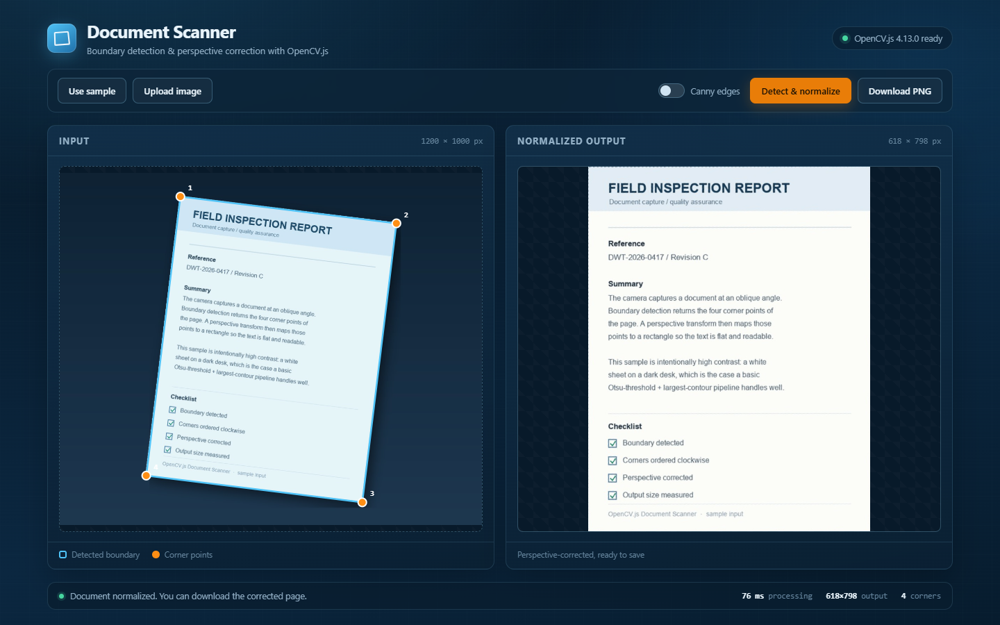

# opencvjs-document-scanner

Detect document boundaries and correct perspective distortion entirely in the browser with OpenCV.js. The `DocumentScanner` class lives in `src/document-scanner.ts`; the Vite project in this folder is a demo UI built around it.



[Demo video](./demo.mp4)

## Run the demo

```bash
npm install
npm run dev
```

Open the printed local URL. The demo loads a sample document automatically:

- **Detect & normalize** runs grayscale conversion → Gaussian blur → Otsu threshold → largest contour → corner classification → `cv.warpPerspective`.
- The detected quad and its four corner points are drawn over the input image.
- **Upload image** or drag and drop to use your own photo.
- **Canny edges** switches the first stage to Canny edge detection, which helps with uneven lighting.
- **Download PNG** saves the corrected page.

The first load needs network access because OpenCV.js 4.8.0 is pulled from `https://docs.opencv.org/4.8.0/opencv.js`. You can also vendor that file to `public/opencv.js` (gitignored) and change the `<script src>` in `index.html` for offline use.

## Use the scanner class in your own project

This sample is not published to npm. Copy `src/document-scanner.ts` into your project (it has no dependencies beyond OpenCV.js) and import it directly:

```ts
import { DocumentScanner } from './document-scanner';
```

OpenCV.js itself must be loaded before you construct the scanner:

```html
<script>
  var Module = {
    onRuntimeInitialized() {
      window.dispatchEvent(new Event('opencv-ready'));
    }
  };
</script>
<script async src="https://docs.opencv.org/4.8.0/opencv.js"></script>
```

Wait for `window.cv.Mat` (or the `opencv-ready` event) before creating an instance.

## Usage

```js
const scanner = new DocumentScanner();

// 1. Find the four corner points of the page.
const img = document.getElementById('photo');
const points = scanner.detect(img, { useCanny: false });

// 2. Warp the quad into a flat, cropped page.
const canvas = scanner.crop(img, points);
document.getElementById('output').src = canvas.toDataURL('image/png');
```

`detect()` and `crop()` accept an `HTMLImageElement` or an `HTMLCanvasElement`. If you omit `points`, `crop()` runs detection itself. `ScanOptions.useCanny` defaults to `false`; enable it when the background and the document have similar brightness.

A minimal example that imports the class directly lives at [`example/vanilla.html`](./example/vanilla.html); open it through the Vite dev server, not from the file system.

## Scope

This is a teaching baseline for **static images**. It returns four corner points and a corrected canvas; it has no confidence score, no stability check, and no live-camera auto-capture. For production scanning (multi-page capture, quad editing, PDF export, auto-capture stabilization), see the [Dynamsoft Capture Vision multi-page scanner tutorial](https://www.dynamsoft.com/codepool/build-multi-page-document-scanner-web-app.html).

## Build

```bash
npm run build
```

Runs the TypeScript check and writes the Vite build output to `dist/`.

## Blog

[How to Build a Browser Document Scanner with OpenCV.js and JavaScript](https://www.dynamsoft.com/codepool/web-document-scanner-with-opencvjs.html)
